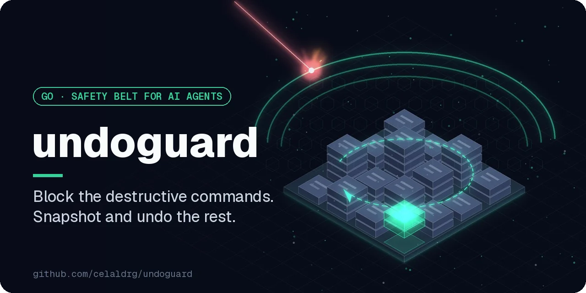
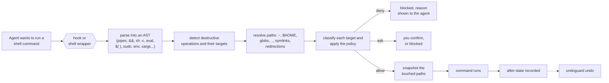
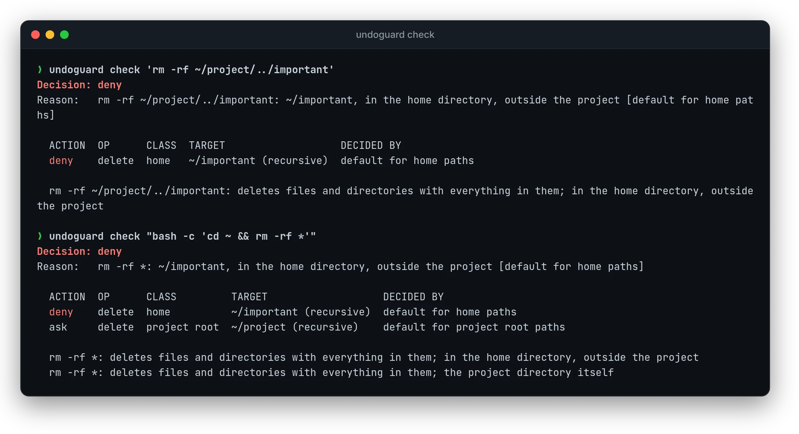
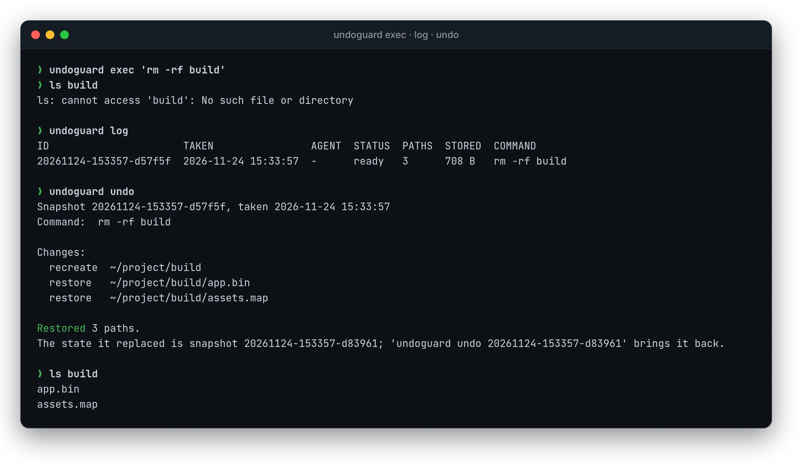

<p align="center">
  
</p>

<h3 align="center">A safety belt for AI coding agents: destructive shell commands are blocked, everything else is snapshotted and one command away from undone.</h3>

<p align="center">
  <a href="https://github.com/celaldrg/undoguard/actions/workflows/ci.yml"></a>
  <a href="https://github.com/celaldrg/undoguard/releases"></a>
  <a href="LICENSE"></a>
  
  
</p>

<p align="center">
  
</p>

undoguard sits between an agent
(Claude Code, Codex CLI, Gemini CLI, or anything that runs shell
commands) and your machine. It reads every shell command before it runs,
blocks the destructive ones, snapshots whatever an allowed command is
about to touch, and gives you one command to undo it.

It is a single static binary for Linux and macOS, with no daemon and no
network access. Besides shell commands it snapshots the files an agent's
own edit tools write (Claude Code `Write` / `Edit`, Codex `apply_patch`,
Gemini CLI `write_file` / `replace`), so those are undoable too.

## The problem

Coding agents run shell commands on your machine, often many per minute,
and you approve them in a hurry or not at all. Most of those commands are
harmless. A few are not:

- `rm -rf ~/project/../important` looks like it stays in the project and
  does not.
- `git reset --hard`, `git clean -fdx` or `git checkout -- .` throw away
  work that was never committed.
- `find . -name '*.log' -exec rm {} +` with a wrong starting point,
  `mv` over an existing file, `> file` on the wrong file.
- `docker system prune`, `kubectl delete`, `DROP TABLE` in `psql`: things
  that live outside the project and cannot be undone with git.

This is not hypothetical:

- An agent asked to reboot a server "went back on the server, fucked up
  mounts, fucked up systemd, fucked up containers, ran random scripts":
  [openai/codex#59060](https://github.com/openai/codex/issues/59060),
  3,400+ reactions.
- "Please make /undo back", because the agent deleted files git did not
  track: [openai/codex#9203](https://github.com/openai/codex/issues/9203),
  550+ reactions.
- Tens of thousands of notes deleted against explicit instructions:
  [google-gemini/gemini-cli#26856](https://github.com/google-gemini/gemini-cli/issues/26856).
- `rm` with an absolute or `~` path deletes outside the working directory,
  and "Claude Code doesn't implement sandboxing for Bash commands":
  [anthropics/claude-code#3275](https://github.com/anthropics/claude-code/issues/3275).
- Claude Code's own checkpoints say it plainly: "A file that only Bash
  commands changed isn't tracked" ([docs](https://code.claude.com/docs/en/checkpointing)).

Allow-lists of command names do not help much: the same `rm` is fine in
`build/` and a disaster in `~`. What matters is *what the command
touches*, and that needs a real parser.

## How it works



1. **Parse.** The command line is parsed with
   [mvdan.cc/sh](https://github.com/mvdan/sh) into a syntax tree. undoguard
   walks every simple command in it, including pipelines, lists, subshells,
   command substitutions, `sh -c` / `bash -c` scripts, `eval`, and the
   commands that `xargs`, `find -exec`, `sudo`, `env`, `nice`, `nohup`,
   `time`, `command`, `builtin`, `timeout` and similar wrappers start.
   Absolute program paths such as `/bin/rm` are treated like `rm`.
2. **Detect.** Each command is checked against detectors for file
   deletion and overwriting, permission changes, git operations that
   discard work, containers, clusters, services, databases and disks.
3. **Resolve.** Targets are resolved the way the shell and the command
   would: `~`, `$HOME`, variables assigned earlier in the same line, globs,
   `..`, symlinks (in both written and physical form) and redirections. A
   target that cannot be known before the command runs is *unresolved*.
4. **Decide.** Each target falls into a class (project, home, protected,
   scratch, ...) whose action comes from the policy, and user rules can
   change it. The command gets the strictest action of all its targets:
   **allow**, **ask** or **deny**.
5. **Snapshot.** Before an allowed command runs, everything it may change
   is copied into a content-addressed store, using reflinks
   (`FICLONE` on Linux, `clonefile` on macOS) where the file system
   supports them, so a snapshot of a large tree is nearly free.
6. **Undo.** `undoguard undo` puts the paths back as they were, with their
   modes and modification times, and refuses to overwrite anything that
   changed again since, unless you pass `--force`.

## Install

With Go 1.26 or newer:

```sh
go install github.com/celaldrg/undoguard/cmd/undoguard@latest
```

Or from a checkout:

```sh
git clone https://github.com/celaldrg/undoguard
cd undoguard
go build -trimpath -o undoguard ./cmd/undoguard
install -m 0755 undoguard ~/.local/bin/
```

Release archives for linux and darwin on amd64 and arm64 are built with
[goreleaser](https://goreleaser.com) from `.goreleaser.yaml`.

## Quickstart

```sh
# 1. Install the hooks for every agent that is set up on this machine.
#    Settings files are backed up first; running it again is safe and
#    never adds duplicate entries.
undoguard init

# 2. See what the guard thinks of a command, without running it.
undoguard check 'rm -rf ~/project/../important'
undoguard check 'git clean -fdx'

# 3. Work with your agent as usual. When something went wrong:
undoguard log              # what was snapshotted
undoguard diff <id>        # what changed since
undoguard undo             # undo the last command
undoguard undo --last 3    # undo the last three, newest first
undoguard undo --session   # undo everything the agent session did
```

For an agent without hook support, wrap its shell instead:

```sh
undoguard run -- some-agent --its-flags
```

## Example

<p align="center">
  
  <br><sub>Real output: a path that looks like it stays in the project resolves to <code>~/important</code> and is denied.</sub>
</p>

<p align="center">
  
  <br><sub>Real output: an allowed <code>rm -rf build</code> was snapshotted first; <code>undoguard undo</code> brings it back.</sub>
</p>

This is the output of [`examples/demo.sh`](examples/demo.sh), which works
in a throwaway home directory: a deletion that escapes the project is
blocked, and a deletion inside it is allowed, snapshotted and undone.
`scripts/update-readme-examples.sh` builds the binary, runs the demo and
pastes its real output below; until it has been run, the block below holds
only a placeholder.

<!-- demo-output:start -->
```console

$ undoguard check 'rm -rf ~/project/../important'
Decision: deny
Reason:   rm -rf ~/project/../important: ~/important, in the home directory, outside the project [default for home paths]

  ACTION  OP      CLASS  TARGET                   DECIDED BY
  deny    delete  home   ~/important (recursive)  default for home paths

  rm -rf ~/project/../important: deletes files and directories with everything in them; in the home directory, outside the project

$ undoguard exec --shell /bin/sh -- -c 'rm -rf ~/project/../important'
undoguard: blocked: rm -rf ~/project/../important: ~/important, in the home directory, outside the project [default for home paths]

$ undoguard check 'rm -rf build'
Decision: allow
Reason:   rm -rf build: ~/project/build, inside the project ~/project [default for project paths]

  ACTION  OP      CLASS    TARGET                       DECIDED BY
  allow   delete  project  ~/project/build (recursive)  default for project paths

  rm -rf build: deletes files and directories with everything in them; inside the project ~/project

Snapshot before running:
  ~/project/build (recursive)

$ undoguard exec --shell /bin/sh -- -c 'rm -rf build'

$ undoguard log
ID                      TAKEN                AGENT  STATUS  PATHS  STORED  COMMAND
20261124-153108-57c953  2026-11-24 15:31:08  -      ready   2      16 B    rm -rf build

$ undoguard undo
Snapshot 20261124-153108-57c953, taken 2026-11-24 15:31:08
Command:  rm -rf build

Changes:
  recreate  ~/project/build
  restore   ~/project/build/app.bin

Restored 2 paths.
The state it replaced is snapshot 20261124-153108-5a18e8; 'undoguard undo 20261124-153108-5a18e8' brings it back.

$ cat build/app.bin
compiled output

demo: all steps behaved as expected
```
<!-- demo-output:end -->

## What it detects

| Area | Commands and forms |
|---|---|
| Files | `rm`, `rmdir`, `unlink`, `shred`, `truncate`, `mv` and `cp` onto existing files, `install`, `ln -f`, `rsync --delete` and friends, `tee`, `dd of=`, `sed -i`, output redirections (`>`, `>>`, `>|`, `&>`) |
| Archives | `tar -x` (also `xzf`-style and `--extract`) into `-C` / `--directory` or the working directory, `unzip -o` / `-f` / `-u` into `-d` |
| Agent file tools | Claude Code `Write`, `Edit`, `MultiEdit`, `NotebookEdit`; Codex `apply_patch` (adds, updates, moves, deletes); Gemini CLI `write_file`, `replace`. These are snapshotted wherever they write and blocked only on protected paths, policy files or your own path rules: the agents already ask before their file tools write outside the project |
| Find and xargs | `find -delete`, `find -exec rm`, `-execdir`, `-ok`, `-fprint`; `xargs rm` and anything else `xargs` runs |
| Permissions | `chmod`, `chown`, `chgrp`, recursive or not |
| Git | `reset --hard`, `clean -f`, `checkout -- .` and other path checkouts, `restore`, `switch -f`, `stash drop` / `clear`, `branch -D`, `rm`, `mv`, `push --force` / `--delete` / `+ref`, `reflog expire`, `gc --prune`, `update-ref`, `read-tree`, `checkout-index`, `filter-branch`, `filter-repo`, `worktree remove`; `git -c` / `--config-env` settings that make git run other programs, and `--exec-path` |
| Containers | `docker` / `podman` / `nerdctl`: `rm`, `rmi`, `system prune`, `volume rm` / `prune`, `network rm`, `container prune`, `image prune`, ...; `docker compose down -v` |
| Clusters | `kubectl` / `oc`: `delete`, `drain`, `replace --force`, `apply --prune`; `helm uninstall` |
| Services | `systemctl stop` / `disable` / `mask` / `kill` / ..., `service ... stop`, `launchctl` unload and remove, `crontab -r` and replacing the crontab, `shutdown`, `reboot`, `halt`, `poweroff` |
| Databases | SQL given to `psql`, `mysql` / `mariadb` and `sqlite3` through `-c`, `-e`, arguments, here-documents or here-strings: `DROP`, `TRUNCATE`, `DELETE` and `UPDATE` without `WHERE`, `ALTER ... DROP`; SQL from a file (`psql -f`, `< file`) or from an `echo` / `printf` / `cat` pipe is read and checked too, and SQL that cannot be read beforehand makes the command ask; `dropdb`, `mysqladmin drop`, `redis-cli FLUSHALL` / `FLUSHDB` / `SHUTDOWN` / `EVAL` / `SCRIPT FLUSH` / ... |
| Disks | file system and partition tools (`mkfs*`, `mke2fs`, `newfs`, `wipefs`, `fdisk`, `parted`, `sgdisk`, `diskutil erase*`, ...), writes to block devices |
| Scripts | shell scripts started by path, with `bash file.sh` or with `source` are read and checked like the command line itself |
| Unknowns | a program name or an argument only known at run time; `eval` or `trap` of code only known at run time; code for another language (`python -c`, `node -e`, `perl -e`, `ruby -e`, `php -r`, `awk`, ... and scripts for those interpreters) that mentions removing, renaming or writing files or starting processes; `fish`, `csh`, `pwsh` and similar shells given code |

Every command line can be checked with `undoguard check`, which also
shows the snapshot plan.

## Policy

The policy lives in `~/.config/undoguard/policy.toml` (or
`$XDG_CONFIG_HOME/undoguard/policy.toml`, or
`$UNDOGUARD_CONFIG_DIR/policy.toml`). A repository can add a
`.undoguard.toml` at its root, which can only make things **stricter**.
Both files are optional; `undoguard policy` prints the merged result and
where every part came from. See [`examples/policy.toml`](examples/policy.toml)
and [`examples/project.undoguard.toml`](examples/project.undoguard.toml).

### Classes

Every path or resource a command touches falls into the first class that
fits:

| Class | What | Default |
|---|---|---|
| protected | the built-in list (`~/.ssh`, `~/.aws`, `~/.gnupg`, `~/.config`, `~/.kube`, `~/.docker`, `~/.netrc`, `~/.git-credentials`, `/etc`, `/usr`, `/bin`, `/System`, `/Library`, ...), your `protected` entries, and undoguard's own data and config directories | **deny**, always |
| policy file | the project's `.undoguard.toml` | ask |
| project root | the project directory itself, as a whole | ask |
| project | inside the project (the git work tree, an agent's project directory, or the current directory) | allow, after a snapshot |
| scratch | `$TMPDIR`, `/tmp`, `/var/tmp` and your `scratch` entries | allow, no snapshot |
| home | the home directory outside the project | **deny** |
| elsewhere | any other path | ask |
| unresolved | a path or code that is only known at run time | ask |
| external | databases, containers, clusters, services, remote repositories | ask |
| critical | disks, partitions, file systems | **deny** |

A directory that holds the home directory or the project is never
treated as scratch, and a project at or above the home directory is not
treated as a project.

### Keys

| Key | Meaning |
|---|---|
| `protected = [...]` | extra protected paths (`~`, `$HOME` and absolute paths) |
| `unprotected = [...]` | remove entries from the built-in protected list (user file only) |
| `scratch = [...]` | extra disposable directories (user file only) |
| `[defaults]` | the action per class: `project`, `project_root`, `scratch`, `home`, `elsewhere`, `unresolved`, `external`, `critical`; each is `allow`, `ask` or `deny` |
| `[snapshot]` | `max_file_size` (512MiB), `max_total_size` per command (2GiB), `max_files` paths per command (50000), `store_limit` (10GiB), `keep_days` (14), `keep_min` (20); sizes take `k`, `M`, `G`, `T` with or without `i`, all powers of 1024; 0 means no cap (user file only) |
| `[[rule]]` | `name`, `command`, `finding`, `path`, `action`, `reason` |

### Rules

A rule matches when every pattern it sets matches:

- `command` is matched against each simple command, written as the
  program name followed by its arguments: `"git push *--force*"`.
- `finding` is matched against the detector that fired, such as `rm`,
  `git-push-force`, `git-reset-hard`, `docker-rm`, `docker-system-prune`,
  `kubectl-delete`, `psql`, `mysql`, `sqlite` or `redirect`. Parts of a
  command line that cannot be seen through are named `issue-<kind>`, such
  as `issue-dynamic-code` or `issue-script`. `undoguard check --json`
  shows the name of each finding.
- `path` is matched against each target path as written and against the
  form (written or with symlinks resolved) that decided its class. In a
  path, `*` and `?` do not cross `/`, `**` does,
  and a trailing `/**` also matches the directory itself.

The strictest matching rule of the user file replaces the class action,
so a user rule may loosen a default (allow `docker-rm`, say), but never a
protected path. Project rules can only ask or deny, and only tighten.

## Agent integration

`undoguard init` adds hook entries to each agent's settings, after
writing a timestamped backup next to the file. It keeps the file's
indentation and every other entry, writes atomically, and recognises its
own entries, so a second run reports "already set up". `--dry-run` prints
the diff instead, `--remove` takes the entries out again, and `--agent
claude,codex,gemini` picks agents (by default every agent whose config
directory exists).

| Agent | File | Hooks | On "ask" |
|---|---|---|---|
| Claude Code | `~/.claude/settings.json` (or `$CLAUDE_CONFIG_DIR`) | `PreToolUse` and `PostToolUse` on `Bash\|Write\|Edit\|MultiEdit\|NotebookEdit` | Claude asks you to confirm |
| Codex CLI | `~/.codex/hooks.json` (or `$CODEX_HOME`) | `PreToolUse` and `PostToolUse` on `Bash\|apply_patch` | blocked with the reason; Codex hooks cannot ask yet |
| Gemini CLI | `~/.gemini/settings.json` | `BeforeTool` and `AfterTool` on `run_shell_command\|write_file\|replace` | blocked with the reason; Gemini hooks cannot ask |

Codex runs a new or changed hook only after you trust it: open `/hooks`
in Codex once after `init`.

The entries look like [`examples/claude-settings.json`](examples/claude-settings.json),
[`examples/codex-hooks.json`](examples/codex-hooks.json) and
[`examples/gemini-settings.json`](examples/gemini-settings.json), with the
absolute path of the binary. Restart the agents after `init`.

### Without hooks

`undoguard run -- <agent> [args]` starts the agent with temporary
wrappers for `sh`, `bash`, `zsh`, `dash` and `ksh` first on its `PATH`
and in `$SHELL`. Every `-c` command line those shells get is checked,
snapshotted and run through `undoguard exec`; all of them share one
session, so `undoguard undo --session-id <id>` undoes the whole run. The
same wrapper can be installed by hand: see
[`examples/shell-wrapper.sh`](examples/shell-wrapper.sh). Nobody can
answer an "ask" there, so the wrapper blocks it with exit status 126.

## Commands

| Command | What it does |
|---|---|
| `check [--json] [--dir DIR] '<line>'` or `check -- <prog> <args>` | print the decision, every finding with its class and rule, and the snapshot plan; exit 0 allow, 3 ask, 2 deny |
| `init [--agent LIST] [--dry-run] [--remove]` | install or remove the agent hooks |
| `run [--agent NAME] -- <agent> [args]` | run an agent with its shells wrapped |
| `exec [--shell PATH] [--agent NAME] [--session ID] -- ...` | check, snapshot and run one command; what the wrappers call |
| `hook <claude\|claude-post\|codex\|codex-post\|gemini\|gemini-post>` | the hook entry point; reads the agent's JSON on stdin |
| `log [--all] [--json] [-n N] [--session ID]` | list snapshots, or with `--all` every guard decision from the journal |
| `diff [--stat] [<id>]` | show how the paths of a snapshot (by default the one `undo` would restore) differ from now, with a unified diff for text files |
| `undo [--force] [--dry-run] [--last N \| --session \| --session-id ID \| <id>]` | restore the last snapshot, the last N, one snapshot, or a whole session, newest first |
| `gc [--dry-run]` | delete snapshots past `keep_days` (always keeping `keep_min`), trim the store to `store_limit`, and remove unused stored files; also runs on its own at most once a day after `exec` or an after-hook |
| `policy [--dir DIR]` | print the merged policy, its sources and its warnings |
| `version` | print the version |

Snapshot ids can be shortened to any unique prefix. An undo is itself
snapshotted first, so it can be undone too.

### Exit codes

| Code | Meaning |
|---|---|
| 0 | success; for `check`, allow |
| 1 | error |
| 2 | `check`: deny |
| 3 | `check`: ask |
| 126 | `exec`: the command was blocked and did not run |
| 127 | `exec`: the shell or program could not be started |

Otherwise `exec` exits with the status of the command it ran, or 128 plus
the signal number if the command was killed by a signal.

### Files and environment

| Path or variable | Use |
|---|---|
| `~/.local/share/undoguard` | snapshots, the object store and `journal.jsonl`; moved by `$XDG_DATA_HOME` or `$UNDOGUARD_HOME` |
| `~/.config/undoguard/policy.toml` | the user policy; moved by `$XDG_CONFIG_HOME` or `$UNDOGUARD_CONFIG_DIR` |
| `UNDOGUARD_PROJECT` | force the project directory; `CLAUDE_PROJECT_DIR` and `GEMINI_PROJECT_DIR` are used when set |
| `UNDOGUARD_SESSION`, `UNDOGUARD_AGENT` | session id and agent name recorded with snapshots made by `exec` |

The journal records every decision that was not a plain allow, and every
allowed destructive command. Before anything is written there, it masks
passwords in URLs, `--password` / `--token` style options, `-p<password>`
after `mysql`, `mysqldump` and `mysqladmin`, `Authorization` headers, and
variables whose names contain `PASSWORD`, `PASS`, `TOKEN`, `SECRET`,
`API_KEY`, `ACCESS_KEY` or `CREDENTIAL`. Each snapshot's `manifest.json`
keeps the command exactly as written, unmasked, so that `log` and `undo`
can show it. The store and the journal are readable only by you.

## Limits

undoguard makes the common accidents recoverable. It is not a sandbox, and
an agent that wants to get around it can. Known gaps:

- **Programs that a checked command starts by itself are not seen**:
  `make clean`, `npm run reset`, a test suite or a git alias run whatever
  they contain unchecked. An agent's file tools other than the ones listed
  above, and MCP tools, do not go through undoguard either.
- **Other languages are only screened.** Inline code (`python -c`,
  `node -e`, ...) and scripts for other interpreters are matched against
  a list of risky words; a match makes the command ask, and code without
  one runs unchecked and without a snapshot. Compiled programs are not
  looked into, and neither are the commands given to `docker exec`,
  `kubectl exec` or `ssh`.
- **Codex CLI and Gemini CLI cannot ask.** Their hooks can only allow or
  block, so "ask" blocks with an explanation. With Codex versions that
  have no `PostToolUse` hook, a snapshot is closed by the next command
  instead.
- **Archives are treated as a whole.** `tar -x` and `unzip -o` are taken
  to replace anything in their target directory, which is snapshotted
  recursively; the archive's listing is not read. Extracting into the
  project root therefore asks.
- **The shell wrappers are easy to bypass**: a command that calls
  `/bin/bash` by absolute path, or a script file, is not checked. Hooks are
  the stronger integration.
- **Undo needs the state after the command.** That is recorded by the
  after-hook or by `exec`. If it is missing (the agent crashed, or a
  Claude Code command failed so its post-hook never ran), `undo` refuses
  unless you pass `--force`. Two identical commands run in parallel in
  one session may have their snapshots paired the wrong way round.
- **Change detection uses size, mode and modification time.** A file
  rewritten with the same size and time is not seen as changed.
- **Restores are close, not perfect.** Contents, modes, modification
  times and symlink targets come back; the times and modes of symlinks
  themselves do not, owners only when undoguard runs as root, and
  extended attributes and ACLs not at all. For git commands such as
  `git clean -d`, empty directories that git does not track are not
  snapshotted.
- **New files are allowed almost anywhere.** Creating a file or directory
  that does not exist yet is allowed everywhere except under protected
  paths, and rules are not applied to it. It is snapshotted as absent,
  so `undo` removes it again.
- **Path rules see two forms of a path.** A rule is matched against the
  path as written and the form that decided its class; when both forms
  land in the same class, a rule written for the real target of a
  symlink can be missed.
- **Big snapshots are refused.** When a command would need more than the
  `[snapshot]` limits, or a snapshot fails, an allow becomes an ask.
- **External changes cannot be undone.** Databases, containers, clusters,
  services and remotes are only ever guarded, never snapshotted.
- **SQL detection is pattern-based.** It reads the statements it is given
  on the command line, in here-documents, in files it can read and in
  simple `echo` / `printf` / `cat` pipes; a `mysql -p"$PASS"` style
  argument or SQL it cannot predict makes the command ask.
- **Secret masking in the journal is best effort.** Unusual formats can
  slip through.
- **`init` recognises its own entries by the word `undoguard` in the
  binary path.** Renaming the binary to something else makes a second
  `init` add duplicate entries.

## Development

```sh
go vet ./...
go test -race ./...
golangci-lint run            # v2, see .golangci.yml
sh examples/demo.sh          # needs undoguard on PATH, or UNDOGUARD=./undoguard
sh scripts/update-readme-examples.sh
```

The code is laid out as `cmd/undoguard` (the binary) and `internal/`:
`parser` (shell AST walking and word expansion), `detect` (the
detectors), `policy` (loading, classes and rules), `guard` (puts them
together), `snapshot` and `store` (snapshots, restore, gc), `hooks`
(agent hook formats), `jsonedit` (order-preserving JSON editing for
`init`), `journal`, `textdiff`, `flock`, `gitops`, `paths` and `cli`.
CI runs vet, the tests with the race detector and the demo on Ubuntu and
macOS, and golangci-lint on Ubuntu. The example output in this README
comes from `scripts/update-readme-examples.sh`; snapshot ids and times
change on every run.

## Uninstall

```sh
undoguard init --remove
rm -rf ~/.local/share/undoguard ~/.config/undoguard
```

Then delete the binary.

## License

[MIT](LICENSE)
